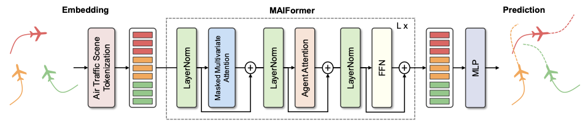

# MAIFormer

**Multi-Agent Inverted Transformer for Flight Trajectory Prediction**

Seokbin Yoon and Keumjin Lee · *IEEE Transactions on Intelligent Transportation Systems*, 2026

[IEEE paper](https://doi.org/10.1109/TITS.2026.3689290) · [arXiv](https://arxiv.org/abs/2509.21004) · [BibTeX](#citation)

MAIFormer forecasts the future trajectories of multiple aircraft from their observed flight histories. The model was evaluated on real-world ADS-B trajectories from the terminal airspace of Incheon International Airport.

## Architecture



Each input variable's observation history becomes a single token. A stack of encoder layers applies two attention operations before a feed-forward network.

- **Masked multivariate attention** restricts attention to variables from the same aircraft, such as latitude, longitude, and altitude.
- **Agent attention** concatenates each aircraft's variable tokens into an aircraft representation and models interactions across aircraft.

The prediction head projects each variable token to its future time series. The model can also return both sets of attention weights for inspection.

## Quick start

```bash
git clone https://github.com/seokbinyoon96/maiformer.git
cd maiformer
python -m pip install torch numpy
```

Run the following from the repository root. The example uses synthetic inputs to demonstrate the API.

```python
import torch

from model import MAIFormer
from utils import to_model_layout

batch_size, history_steps, forecast_steps = 2, 12, 6
num_aircraft, num_variables = 4, 3

model = MAIFormer(
    seq_len=history_steps,
    pred_len=forecast_steps,
    n_vars=num_variables,
).eval()

history = torch.randn(batch_size, history_steps, num_aircraft, num_variables)
x = to_model_layout(history)

with torch.inference_mode():
    prediction, agent_attention, multivariate_attention = model(
        x, return_attn=True
    )

print(prediction.shape)  # torch.Size([2, 6, 12])
```

The example uses randomly initialized weights. To produce trained forecasts, train the model on trajectory data or load compatible weights.

## Input and output

| Argument or result | Shape | Meaning |
| --- | --- | --- |
| `x` | `(B, seq_len, N * n_vars)` | Observed histories with each aircraft's variables stored together |
| `agent_mask` (optional) | `(B, N)` | Boolean mask with `True` for real aircraft and `False` for padding |
| `prediction` | `(B, pred_len, N * n_vars)` | Forecasts in the same variable order as the input |

Here, `B` is the batch size and `N` is the number of aircraft slots. With `return_attn=True`, the model also returns two lists of per-layer attention tensors. Agent attention has shape `(B, N, N)`. Masked multivariate attention has shape `(B, N * n_vars, N * n_vars)`.

## Repository contents

| File | Contents |
| --- | --- |
| [`model.py`](model.py) | Input embedding, encoder stack, and forecast projection |
| [`encoder.py`](encoder.py) | Masked multivariate attention, agent attention, and feed-forward layers |
| [`utils.py`](utils.py) | Tensor layout conversions, masked MSE, displacement metrics, and reproducibility helpers |

The repository contains the model and utilities. The study dataset, trained checkpoints, and training scripts are not included. The `ade_fde` helper computes Euclidean distances in the units of its inputs. Convert normalized or geographic coordinates to the intended distance units before reporting displacement metrics.

## Citation

If you use MAIFormer in your research, please cite the journal article.

```bibtex
@article{yoon2026maiformer,
  author  = {Yoon, Seokbin and Lee, Keumjin},
  title   = {Multi-Agent Inverted Transformer for Flight Trajectory Prediction},
  journal = {IEEE Transactions on Intelligent Transportation Systems},
  year    = {2026},
  volume  = {27},
  number  = {9},
  pages   = {11516--11526},
  doi     = {10.1109/TITS.2026.3689290}
}
```
